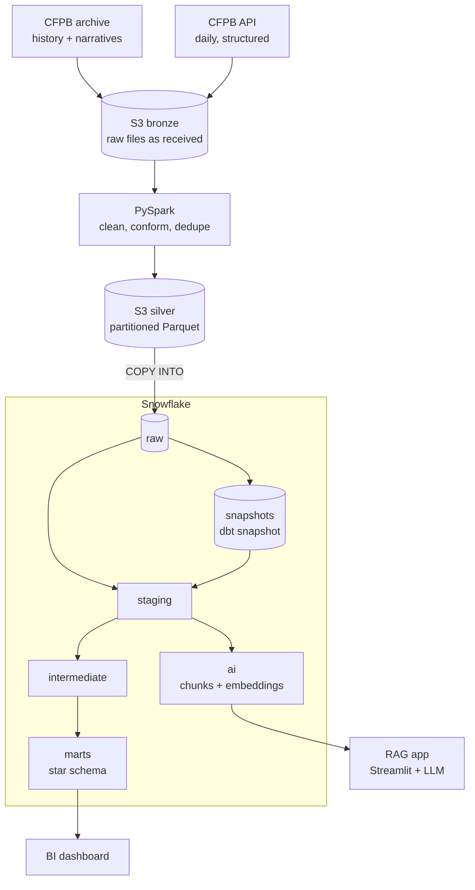
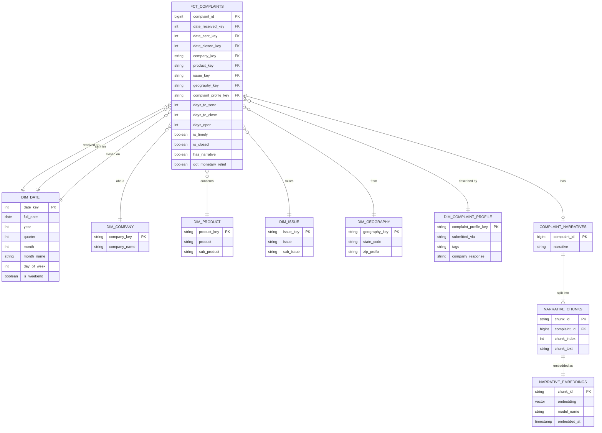

# Design: CFPB Complaints Pipeline

**Status:** Draft v1 — written before build, will be updated as decisions change
**Author:** Ayomide Alayande

---

## 1. Purpose

An end-to-end data pipeline over the CFPB Consumer Complaint Database. It ingests complaint data, processes it with PySpark, models it in Snowflake with dbt, and serves two consumers: a BI dashboard and a retrieval-augmented generation (RAG) app over complaint narratives.

The project is built to demonstrate:

- Orchestration with Airflow (scheduling, dependencies, retries, alerting, backfills)
- Large-volume processing with PySpark
- Dimensional modelling, testing and change tracking with dbt
- Engineering practice: containers, Git branching and pull requests, CI/CD
- Data pipelines that feed an AI application

---

## 2. Stakeholders and business questions

**Primary stakeholder:** a bank's complaints and compliance team.
**Secondary:** industry analysts benchmarking complaint handling across companies.

### Volume and trends
- How many complaints are received per month, by product, issue, company and state?
- Which issues are growing fastest month over month, and when did a spike begin?

### Company performance
- What share of each company's responses are timely?
- What is the mix of response outcomes (e.g. closed with monetary relief vs closed with explanation)?
- How long does the CFPB take to forward a complaint to the company?
- How long do companies take to close complaints? *(see section 8 for limits)*

### Who is complaining and how
- Which submission channels are used (web, phone, referral)?
- How many complaints carry tags such as Older American or Servicemember?
- How do complaints vary by state?

### From the narrative text (AI layer)
- What are consumers saying about a given product and company?
- What themes sit behind a spike in complaints?
- Which past complaints are most similar to a new one?

### Known analytical limitations
- **Counts reflect company size.** The data has no customer base figures, so companies are compared on rates and shares, not raw counts.
- **One product dominates.** Credit reporting is about 90% of complaints, so dashboards need a product filter and comparisons should be made within products.
- **Narratives are limited.** They exist only where the consumer consented to publication, stopped on 14 August 2026, and are almost absent from the most recent exports.
- **Some fields no longer exist.** Consumer consent and consumer disputed are in neither the archive nor the API.

---

## 3. Data sources

| Source | Content | Coverage | Format | Load pattern |
|---|---|---|---|---|
| CFPB narratives archive (FOIA reading room) | Full records including narratives (16 columns) | Dec 2011 – Aug 2026, in 21 zip files covering periods of different lengths | One CSV per zip | One-off historical backfill, looping over the 21 files |
| CFPB Consumer Complaint Database API | Structured fields only (15 fields, no narratives) | Ongoing, updates daily | JSON | Daily, re-fetching a rolling 180-day window |

**Fields (both sources):** complaint ID, date received, product, sub-product, issue, sub-issue, company public response, company, state, ZIP code, tags, submitted via, date sent to company, company response to consumer, timely response.
**Archive only:** consumer complaint narrative.
**In neither source:** consumer consent, consumer disputed.

The sources differ in schema (the API lacks narratives), so conforming them is an explicit pipeline step. Full profiling results are in `docs/data-exploration.md`.

---

## 4. Architecture

| Component | Technology | Role |
|---|---|---|
| Orchestration | Airflow (Docker) | Schedules and sequences every step; retries; alerts; backfills |
| Runtime | Docker Compose | Runs Airflow and Spark locally, reproducibly |
| Lake | Amazon S3 | Bronze (raw) and silver (cleaned Parquet) layers |
| Processing | PySpark (Docker) | Type enforcement, deduplication, category conforming, partitioning |
| Warehouse | Snowflake | Raw, snapshot, staging, intermediate, marts and AI schemas |
| Transformation | dbt | Business logic, dimensional model, tests, docs, snapshots |
| Embeddings | Python + open-source sentence model | Converts narrative chunks to vectors |
| Vector storage | Snowflake `VECTOR` column | Stores embeddings next to the star schema |
| AI app | Streamlit + LLM API | Answers questions with cited complaint IDs |
| CI/CD | GitHub Actions | Lint, unit tests and `dbt build` on every pull request |

---

## 5. Layers

| Layer | Location | Contents | Rebuildable? |
|---|---|---|---|
| Bronze | S3 `bronze/` | Files exactly as received, organised by source and date | Re-download |
| Silver | S3 `silver/` | Cleaned, conformed Parquet partitioned by `date_received` month | Yes, from bronze |
| Raw | Snowflake `raw` | Silver data loaded with `COPY INTO`; current state only | Yes, from silver |
| Snapshots | Snowflake `snapshots` | Every observed version of every complaint | **No — protect** |
| Staging | Snowflake `staging` | One model per source table: renaming, casting | Yes |
| Intermediate | Snowflake `intermediate` | Joins and multi-step logic (e.g. milestone dates) | Yes |
| Marts | Snowflake `marts` | Facts, dimensions and aggregate marts | Yes |
| AI | Snowflake `ai` | Narratives, chunks and embeddings | Yes (re-embedding has a compute cost) |

---

## 6. Transformation approach: EtLT

- **Small "t" in Spark, before loading:** technical transformations only: renaming columns to snake_case (source names contain spaces and `?`), casting both date columns from text, type enforcement, deduplication, mapping the 2017 and 2023 product/issue category changes to the current taxonomy, and partitioning. No business logic.

- **Big "T" in dbt, inside Snowflake (ELT):** all business logic, metrics, flags and the dimensional model, version-controlled and tested.

**Trade-off acknowledged:** at this volume Snowflake could do the cleaning alone. Spark is used so that conforming logic is independent of the warehouse and the silver layer is usable by any engine.

---

## 7. Data model

### Methodology
Kimball dimensional modelling. Inmon (3NF enterprise warehouse) and Data Vault were rejected as unnecessary for one subject area with two sources.

### Business process and grain
- **Process:** complaint handling
- **Grain:** one row per complaint
- **Fact type:** accumulating snapshot — one row per complaint, updated in place as it reaches each milestone (received → sent to company → closed)

### Tables

**`fct_complaints`**
- `complaint_id` — degenerate dimension and primary key
- Foreign keys to every dimension, plus three role-played date keys: received, sent, closed
- Measures: `days_to_send`, `days_to_close`, `days_open`, `is_timely`, `is_closed`, `has_narrative`, `got_monetary_relief`

**Dimensions**
- `dim_date` — role-playing (received, sent, closed); includes a placeholder row with key `-1` labelled "Not yet closed"
- `dim_company`
- `dim_product` — product and sub-product, using conformed categories
- `dim_issue` — issue and sub-issue, using conformed categories
- `dim_geography` — state and ZIP prefix
- `dim_complaint_profile` — junk dimension combining low-cardinality flags: submission channel, tags, company response

**Aggregate marts**
- e.g. `mart_company_monthly` for dashboard performance

### Conventions
- **Closed status:** a complaint is closed when its response starts with "Closed". "In progress" and "Untimely response" are not closed. This drives `is_closed`, `date_closed` and `days_to_close`.
- **Open milestones:** measures stay `NULL` (never `0`) so averages only include completed milestones; date keys point to `-1` rather than `NULL` so joins never drop rows.
- **Surrogate keys:** generated in dbt with `dbt_utils.generate_surrogate_key`.
- **Current state:** the profile key on the fact reflects the complaint's latest response; history lives in the snapshot.

### ERD

---

## 8. Change tracking

- **Where changes come from:** older archive exports hold mostly final states (the July – August 2025 export has no "In progress" complaints). Recent complaints change after publication: 55% of August 2026 complaints were "In progress", and public responses can be added up to 180 days later. These changes appear only in the API.
- **Rolling window:** the daily load re-fetches all complaints received in the last 180 days, because a complaint's received date does not change when its status does (ADR-012).
- **Mechanism:** a dbt snapshot (`snap_complaints`) on `raw.complaints` records every observed version of each complaint using SCD Type 2 columns (`dbt_valid_from`, `dbt_valid_to`).
- **Model:** `int_complaint_milestones` derives `date_closed` as the earliest `dbt_valid_from` at which the response became a closed status; `fct_complaints` uses it.
- **Not CDC:** this is query-based change tracking. Log-based CDC is not possible because the source database is not ours.
- **Limitations:**
  - Changes are detected at daily granularity; a complaint closing during a missed run is recorded on the next run.
  - No history exists before the first snapshot run, so time-to-close only covers complaints first observed after snapshots begin (unless the API exposes a closing date — to verify).
- **Protection:** separate schema, never full-refreshed, excluded from CI against real schemas.

---

## 9. AI layer

- **Corpus:** narratives for banking products (checking or savings account, credit card, money transfer, mortgage) from the July – August 2025 archive export: 21,904 narratives (ADR-013). Recent exports have almost no narratives. Can expand to all non-credit-reporting products (48,609) by changing a filter.
- **Minimum length:** narratives under 50 characters are excluded (46 rows, 0.02%), as they carry no meaning for retrieval.
- **Chunking:** narratives have a median of 736 and a maximum of 31,498 characters, while the embedding model reads roughly 1,000 characters at most. Narratives are split into ~800-character chunks with ~100-character overlap (ADR-014).
- **Embeddings:** an open-source sentence model run locally (e.g. `all-MiniLM-L6-v2`, 384 dimensions), stored in a Snowflake `VECTOR` column with the model name for traceability.
- **Incremental:** only chunks without an embedding for the current model are processed.
- **Retrieval:** filter on star-schema attributes (product, company, date) first, then rank by vector similarity.
- **Privacy:** narratives are already anonymised by the CFPB (56% contain `XXXX` redactions). Stored text is unchanged; the app may display `XXXX` as `[redacted]` for readability.
- **App:** Streamlit; the LLM answers using retrieved chunks and cites complaint IDs.
- **Evaluation:** a fixed set of ~20 questions with expected relevant complaints, used to measure retrieval quality when chunking or models change.

---

## 10. Orchestration

**DAG 1 — `historical_backfill`** (manual trigger, runs once)
loop over the 21 archive files: download → bronze → Spark → silver → `COPY INTO` raw → dbt build

**DAG 2 — `daily_complaints`** (daily)
API pull of complaints received in the last 180 days → bronze → Spark → silver → `COPY INTO` raw → `dbt snapshot` → `dbt build` → embed new chunks

- **Retries** with backoff on network-bound tasks
- **Alerts** on task failure via callback (Slack or email)
- **Quality gate:** failed dbt tests stop downstream tasks
- **Backfill:** `catchup` with dated, idempotent tasks

---

## 11. Data quality

| Layer | Checks |
|---|---|
| Spark | Schema enforcement; row counts in vs out; duplicate `complaint_id` count |
| Sources | dbt source freshness on `raw.complaints` |
| Staging | `not_null` on complaint ID, date received, date sent to company, product, issue, company, submitted via, company response and timely response; `unique` on complaint ID; `accepted_values` on company response, timely response and submitted via. No `not_null` on tags, company public response, sub-issue, state or ZIP code (optional fields, missing by design) |
| Marts | `relationships` from every fact key to its dimension; singular tests (e.g. `date_sent >= date_received`, `days_to_close` is `NULL` when not closed) |
| AI | Every chunk has exactly one embedding for the current model; no narrative under 50 characters is embedded |

---

## 12. Engineering workflow

- Protected `main`; all changes through pull requests from `feat/`, `fix/`, `chore/` and `docs/` branches
- **CI on every PR:** SQL lint (sqlfluff), `pytest` for Spark transformations, `dbt build` against a dedicated CI schema
- **Later:** slim CI (`state:modified+`) so only changed models and their downstream models run
- Secrets in `.env` locally and GitHub Secrets in CI; never committed

---

## 13. Non-functional requirements

| Requirement | Approach |
|---|---|
| Freshness | Daily, matching the API |
| Idempotency | Partition overwrites in S3; `MERGE` or delete-insert in Snowflake |
| Backfill | Any date range can be re-run |
| Cost | Snowflake warehouse auto-suspend; embed a subset first |
| Security | Least-privilege Snowflake role and IAM user; credentials never in Git |
| Reproducibility | `docker compose up` plus `.env.example` |

---

## 14. Open questions

## 14. Open questions

- [x] Archive file format: one CSV per zip, 16 columns
- [ ] Archive total size: largest zip is 135 MB; full total to be measured during ingestion
- [ ] API pagination, rate limits and how to filter by date
- [ ] Does the API expose a closing date or last-updated timestamp?
- [ ] Full list of product/issue category changes to conform
- [x] Which narrative subset to embed first: banking products, July – August 2025 export (ADR-013)
- [ ] LLM provider for the RAG app
- [ ] Why the August 2026 file contains dates after 14 August
